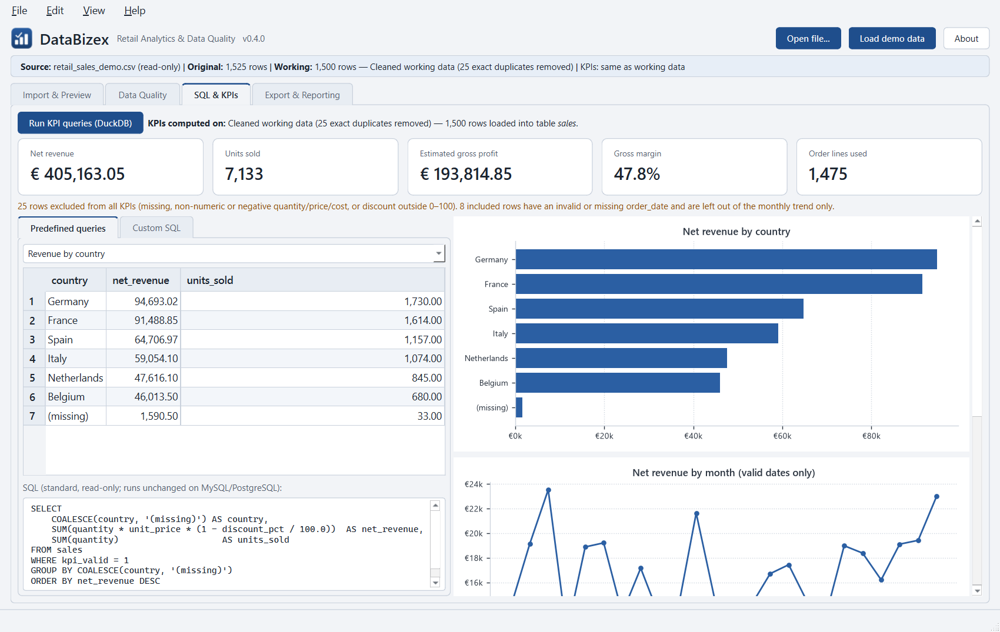
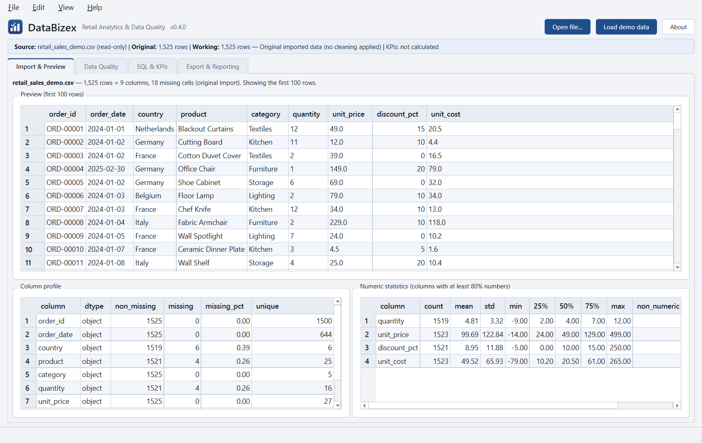
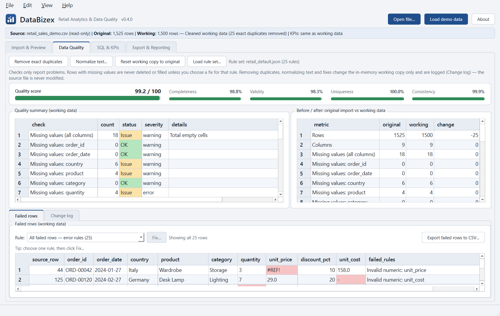
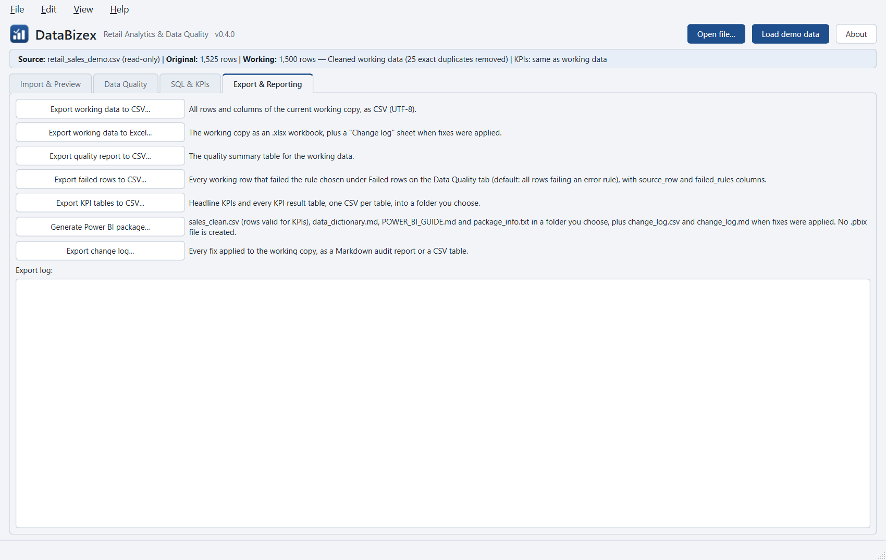

# DataBizex — Retail Analytics & Data Quality

[](https://github.com/DataBizex/databizex-retail-analytics/actions/workflows/tests.yml)

A Windows desktop tool that checks retail sales exports for quality problems,
calculates business KPIs with SQL, and prepares clean data for Power BI.

### 20-second demo
https://github.com/user-attachments/assets/54df7143-94ee-4f4d-8513-8fd6c83d0869



## Download

Get `DataBizex.exe` from the [latest release](https://github.com/DataBizex/databizex-retail-analytics/releases/latest). No installation: download and run.

On first launch, Windows SmartScreen may show "Windows protected your PC". This appears because the executable is not code-signed (a paid certificate), not because anything is wrong. Click **More info**, then **Run anyway**. You can also build the app yourself from this repository and compare.

## Why this project

I built DataBizex from my everyday work as a data analyst in retail and
industry, inspired by retail analytics work at IKEA-France. The pattern
repeats: a messy sales export arrives, and the quality has to be checked
before anyone trusts the numbers. Then come the KPIs business teams ask for,
and clean data handed over to Power BI. This tool puts those steps into one
small, transparent desktop application.

## Business problem

Sales exports often contain duplicate lines, empty cells, broken dates,
text in number columns and impossible values (negative prices, 150 %
discounts). If these go straight into a report, revenue and margin are
wrong and nobody can tell why. Teams need to:

- see what is wrong with a file before using it,
- fix only what is safe to fix (exact duplicates),
- calculate KPIs on valid rows only, with excluded rows reported,
- hand a clean, documented dataset to Power BI.

## Features

**Import & Preview**
- Open `.csv` or `.xlsx` (legacy `.xls` is rejected with an explanation).
- **File > Open Recent** lists the last 10 opened files (name, full path as tooltip), stored
  locally; a file that no longer exists is removed from the list when clicked. The bundled
  sample is not listed.
- Detects `,` `;` tab or `|` delimiters, UTF-8 or Windows-1252 encoding.
- Detects regional number and date formats per column: decimal comma (`43,92`,
  `1.234,56`), thousands separators, and `YYYY-MM-DD`, `DD.MM.YYYY`, `DD/MM/YYYY` or
  `MM/DD/YYYY` dates (ambiguous day/month order is read as DD/MM and flagged).
- **Import Options** dialog when anything differs from the default (comma, UTF-8, dot
  decimal, ISO dates): shows what was detected; delimiter, encoding, decimal and
  thousands separator and date format can each be changed. Numbers and dates are
  converted in the working copy only; values that do not fit keep their text, so the
  quality checks still report them. The settings appear in the source line and in the
  Power BI `package_info.txt`.
- Remembers import settings and column mapping per file layout, stored locally, and
  pre-fills the dialogs next time.
- Preview of the first 100 rows (the full dataset is never put in the GUI).
- Row/column counts, inferred dtypes, missing and unique counts, numeric statistics.
  A column gets statistics when at least 80% of its non-empty values are numbers (same
  parser as the quality checks); the rest are counted as `non_numeric` and left in the data.
- Empty, header-only, unreadable and headerless files handled without crashing.
- **Load sample data** button for the bundled demo file.
- **Map Your Columns** dialog when `quantity`, `unit_price`, `discount_pct`,
  `unit_cost` or `order_date` is not found by name: pick the file's column for each
  expected field (best guess preselected from English, German, French and Dutch header
  keywords, ignoring accents and case) or "(not available)". Only the working copy is renamed; extra columns are kept.

**Data Quality**
- Rule-based checks read from a JSON rule set. The shipped default
  (`rules/retail_default.json`, 25 rules) checks missing values (per column and total), exact
  duplicate rows, repeated `order_id` (catches the same ID with different values, e.g.
  from a broken export or bad join), invalid `order_date`, non-numeric values,
  `discount_pct` outside 0–100, negative quantity / unit_price / unit_cost, unit_price
  below unit_cost, outliers (IQR with a 3.0x multiplier on quantity and unit_price) and
  text variants.
- **Load rule set...** validates any other tabular data (HR, finance, ...) with its own rules.
  Rule types: not_null, dtype, range, allowed_values, regex, unique (on key columns),
  cross_column, outlier, text_variants. See the docstring of `app/data/rules.py` for the
  file format.
- Summary table: check, count, status (OK / Issue / Unavailable), severity (error / warning).
- Quality score: completeness, validity, uniqueness and consistency (% of rows that pass
  all rules of that kind) and their average as an overall score out of 100.
- Outliers are flagged as warnings only; they are never removed or excluded from KPIs.
  The default uses IQR with a 3.0x multiplier (`factor`) rather than the usual 1.5x:
  retail prices are right-skewed, so the 1.5x fence flags a large share of legitimate
  premium products, while 3.0x marks only extreme values. IQR is preferred over z-score
  because z-score assumes an approximately normal distribution, which price data rarely
  is. `method: zscore` (with `threshold`) remains available in custom rule files.
- **Failed rows**: pick a rule (or "All failed rows", which covers error rules) to see the
  rows that failed it, with `source_row` (the line in the source file, header = line 1) and
  `failed_rules` (every rule the row failed). Up to 500 rows are shown; **Export failed rows
  to CSV...** writes all of them.
- In the failed rows table, the cells that caused each failure have a light red background
  (the rule's column or columns; for missing values, the empty cells). Rules without a
  column, such as exact duplicate rows, highlight nothing. Display only: the data is not
  changed.
- **Remove exact duplicates** on the in-memory working copy only.
- **Text variants** (warning, not scored): values in a categorical-looking text column that
  are the same apart from case or spacing (" germany", "GERMANY", "Germany "), and values
  with stray spaces even if they have no other spelling ("Spain " becomes "Spain"). **Normalize
  text...** shows the groups per column and, after you tick columns and click Apply, writes
  each group in the working copy in the letter case of its most frequent variant, trimmed
  and with single spaces. No fuzzy matching: "Deutschland" and "Germany" are never
  merged. **Reset working copy to original** undoes it; the source line
  and `package_info.txt` record which columns were normalized.
- Before/after table: original import vs working data.
- Rows with missing values are never deleted or filled with zero.
  The source file is never modified.

**SQL & KPIs**
- Working data loaded into an embedded DuckDB table `sales`.
- Predefined SQL: headline KPIs, revenue by country, by category,
  by month (valid dates only) with month-over-month (`MoM %`, via `LAG`) and
  year-over-year change (`YoY %`, against the same calendar month a year earlier),
  top 5 products, and a Pareto analysis of products (share and cumulative share of net
  revenue, the smallest set of top products reaching 80%, and "N of M products make 80%
  of net revenue").
- KPI cards: net revenue, units sold, estimated gross profit, gross margin, order lines used.
- Charts (Matplotlib): revenue by country, monthly revenue trend, and a Pareto chart
  (product revenue bars with the cumulative share line and an 80% guide).
- Shows whether KPIs use original or cleaned data, and how many rows were excluded.
- The SQL text for each result is shown in the app.

**Export & Reporting**
- Working data to CSV or Excel; quality report, failed rows and KPI tables to CSV.
- **Generate Power BI package**: `sales_clean.csv`, `data_dictionary.md`,
  `POWER_BI_GUIDE.md`, `package_info.txt`.
- Success messages appear only after the file was written.
  Permission and path errors are shown, not hidden.

## Screenshots

Captured from the running app with `scripts/capture_screenshots.py`.

| Import & Preview | Data Quality |
|---|---|
|  |  |

| SQL & KPIs | Export & Reporting |
|---|---|
|  |  |

## Technology stack

| Purpose | Tool |
|---|---|
| Language | Python 3.11 |
| Desktop GUI | PySide6 (Qt 6) |
| Ingestion, cleaning, profiling | pandas, NumPy |
| Analytical SQL | DuckDB (embedded, in-memory) |
| Charts | Matplotlib |
| Excel read/write | openpyxl |
| Tests | pytest |
| Packaging | PyInstaller |

No web server, cloud service, API or database server is used.

## Architecture and data flow

```
databizex-retail-analytics/
├── app/
│   ├── main.py               entry point, logging, --smoke-test mode
│   ├── paths.py              resource paths (source + PyInstaller bundle)
│   ├── ui/                   main_window.py, data_table.py, dialogs  (PySide6 only)
│   ├── data/                 loader.py, formats.py, column_mapping.py, profiler.py,
│   │                         cleaner.py, rules.py, normalize.py, failed_rows.py
│   ├── analytics/            kpis.py  (KPI definitions, row validity)
│   ├── database/             duckdb_manager.py  (table `sales`, SQL queries)
│   └── exports/              exporter.py  (CSV, Excel, Power BI package)
├── sample_data/              synthetic CSV files + README
├── scripts/                  generate_sample_data.py, capture_screenshots.py
├── tests/                    pytest suite
├── powerbi/                  POWER_BI_GUIDE.md, data_dictionary.md
├── rules/                    retail_default.json (default validation rule set)
├── screenshots/
├── run_databizex.py          launcher used by PyInstaller
└── build_windows.bat
```

```
file (.csv/.xlsx) ──read-only──> original DataFrame ──copy──> working DataFrame (indexed by source line)
                                       │                        │
                                 profile + checks        import conversion (numbers, dates)
                                                         column mapping
                                                         remove exact duplicates / normalize text
                                                                │
                                         prepare: typed columns + kpi_valid / date_valid flags
                                                                │
                                                     DuckDB table `sales` ──SQL──> KPI tables, charts
                                                                │
                                                CSV / Excel / Power BI package (user-chosen paths)
```

All data logic lives outside `app/ui`, so almost all tests run without a window.

### Portable SQL

All reporting queries are standard, read-only SQL
(`SELECT`, `SUM`, `COUNT`, `CASE`, `COALESCE`, `NULLIF`, `CAST`, `ROUND`, `EXTRACT`,
`GROUP BY`, `ORDER BY`, `LIMIT`, and the standard window functions `LAG`, running `SUM`
and a `RANGE BETWEEN 12 PRECEDING AND 12 PRECEDING` frame, with named `WINDOW`s). They run unchanged on MySQL 8+ and PostgreSQL (window functions need
MySQL 8 or later) against a `sales` table with the same columns. DuckDB is used only as an embedded
engine, so no database server is needed.

## KPI definitions and assumptions

| KPI | Definition |
|---|---|
| Net revenue | `quantity × unit_price × (1 − discount_pct / 100)` |
| Gross profit (estimated) | `net revenue − quantity × unit_cost` |
| Gross margin | `gross profit / net revenue` (shown as n/a when net revenue is 0) |
| Units sold | sum of `quantity` over valid rows |

**Row validity.** A row counts towards KPIs only if `quantity`,
`unit_price`, `discount_pct` and `unit_cost` are all present, numeric and
not negative, and `discount_pct` is between 0 and 100. Other rows are
excluded and their number is shown next to the KPIs. They are never
repaired or set to zero.

The monthly trend additionally requires a valid `order_date` (ISO `YYYY-MM-DD`, or one of
the supported regional formats converted on import).
Rows with a missing country, product or category are kept and grouped as
`(missing)`.

**Column mapping.** Fields set to "(not available)" in the mapping dialog:
`discount_pct` is filled with 0 (stated in the KPI note); without `unit_cost`,
rows are valid without a cost and gross profit / margin are shown as n/a;
without `order_date` the monthly trend is n/a; without `quantity` or
`unit_price` KPIs stay unavailable.

**Assumptions:** single currency (EUR in the sample), no returns or refunds,
no taxes, no currency conversion. Gross profit uses unit cost only.

## Run from source

Requires Windows. Tested with Python 3.11.4.

```bat
py -3.11 -m venv .venv
.venv\Scripts\python -m pip install -r requirements.txt
.venv\Scripts\python -m app.main
```

Logs are written to `%LOCALAPPDATA%\DataBizex\databizex.log`.

## Run tests

```bat
.venv\Scripts\python -m pytest
```

The suite has 170 tests, using small fixtures with hand-checked results. They
cover loading valid, empty, header-only, headerless, unsupported and corrupt files;
regional number and date detection and conversion; English, German, French and Dutch
header guessing; remembered file layouts; source line numbers; profiling,
duplicate detection and removal (the source file stays unchanged); every validation
rule type, the quality score formula and the default rule set's counts on the demo
file; failed rows, their highlighted cells and their export; text normalization; KPI
values, DuckDB aggregations, month-over-month, year-over-year and Pareto results; the
recent files list; and the CSV, Excel and Power BI exports. Six tests use Qt's offscreen
platform (four drive the main window, one the mapping dialog, one the table model), so
no screen is needed.

## Build the executable

```bat
build_windows.bat
```

The script creates or reuses `.venv`, installs the requirements, runs the
tests (and stops if any fail), then runs PyInstaller (`--onedir --windowed`)
with `sample_data/`, `powerbi/` and `rules/` bundled. The result is
`dist\DataBizex\DataBizex.exe`. Copy the whole `dist\DataBizex` folder to
share the app.

Optional single-file build:

```bat
build_windows.bat --onefile
```

This also writes `dist\DataBizex.exe` (about 97 MB, one file, sample data and
Power BI docs embedded). It works the same, but every launch first unpacks
itself to `%TEMP%`. On the development machine the window appeared after
about 3.4 s, against about 1.4 s for the folder build. The folder build stays
the default for that reason.

To check a build without clicking through the app:

```bat
dist\DataBizex\DataBizex.exe --smoke-test %TEMP%\databizex_smoke.json
```

This opens the window, loads the sample, removes duplicates, runs the KPIs,
writes a Power BI package and an Excel file to a temporary folder, and
writes the results as JSON.

## Sample dataset

All files in `sample_data/` are **synthetic**: made-up data with no real businesses,
customers or personal information.

`retail_sales_clean.csv` and `retail_sales_demo.csv` are generated with a fixed seed
by `scripts/generate_sample_data.py`: about 1,500 orders across six European
countries, 25 generic products and 2024–2025 dates.
`retail_sales_demo.csv` adds a documented set of problems (25 duplicates, 18
missing values, 8 invalid dates, 6 non-numeric values, 5 out-of-range discounts,
6 negative values). See [sample_data/README.md](sample_data/README.md).

`messy webshop export de.csv` is a synthetic German webshop export (1,235 rows) in
the format German tools write: semicolon delimiter, Windows-1252 encoding, decimal
commas (`43,92`), `DD.MM.YYYY` dates and German headers (Bestellnummer, Bestelldatum,
Land, Artikel, Warengruppe, Menge, Einzelpreis, Rabatt, Einkaufspreis). It
demonstrates the Import Options dialog and the column mapping, which guesses all nine
German headers: read as plain text, no row is valid for KPIs; after conversion and
mapping, 1,183 of 1,235 rows are. It also contains problems the checks report: 35 exact
duplicates, 57 empty cells, 14 invalid dates (e.g. `kein Datum`, `30.02.2025`),
6 unreadable prices (e.g. `k.A.`, `1.299,00 EUR`), 10 discounts outside 0–100 and
9 negative quantities.

## Connect to Power BI

1. In DataBizex, load the data, check quality and remove duplicates.
2. **Export & Reporting → Generate Power BI package** and choose a folder.
3. In Power BI Desktop: **Get data → Text/CSV → sales_clean.csv**.
4. Follow `POWER_BI_GUIDE.md` in the package: measures, KPI cards,
   country/category bar chart, monthly revenue trend.

No `.pbix` file is included; the guide builds the report step by step.
The same guide and data dictionary are in [powerbi/](powerbi/).

## Known limitations

- One table at a time, held in memory: the whole file is loaded, so very large files
  (millions of rows) are slow.
- No joins: data from several files or tables cannot be combined.
- No free-form SQL editor; only the predefined queries run.
- Executables are not code-signed, so Windows SmartScreen may warn on first launch from a
  download.
- Legacy `.xls` files are not supported (save as `.xlsx` or `.csv`), and only the first
  sheet of an Excel file is read.
- Dates must be `YYYY-MM-DD`, `DD.MM.YYYY`, `DD/MM/YYYY` or `MM/DD/YYYY` (or real Excel
  dates), without a time part. One date format and one pair of separators apply to the
  whole file.
- A column whose every value looks like `1.234` (dot thousands, no decimals) is read as a
  decimal number before the import options apply.
- The Import & Preview preview and column profile show the file as read; only the numeric
  statistics use the import-converted values.
- Rule sets are not remembered between sessions.
- Only exact duplicates are removed. A `unique` rule on key columns (e.g. `order_id`)
  reports near-duplicates, but they are not removed.
- Text normalization only merges case and spacing differences; there is no fuzzy matching.
- The packaged app is about 225 MB as a folder (or a 97 MB single exe with slower start).
  No installer yet.
- The UI uses Qt's light colour scheme even when Windows is in dark mode.

## Future improvements

- Removing duplicates by key columns (detection already works via `unique` rules).
- Read-only custom SQL editor with a SELECT-only guard.
- Background thread for loading very large files.
- Windows installer with Inno Setup once the build is stable.
- PDF summary report of the quality checks and KPIs.

## Author

**Ali Soltanhosseini** — data analyst

- Website: [DataBizex.com](https://databizex.com)
- GitHub: [github.com/DataBizex](https://github.com/DataBizex)
- LinkedIn: [linkedin.com/in/ali-soltanhosseini-aut](https://www.linkedin.com/in/ali-soltanhosseini-aut)

## License

MIT — see [LICENSE](LICENSE). Chosen so anyone can read, reuse and adapt the code freely.
